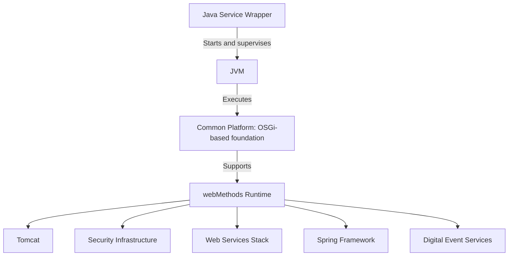

# Understanding the Java Foundations Behind IBM webMethods

*How OSGi, Tomcat, JAAS, Spring and the Java Service Wrapper fit together—and where Spring Boot enters the picture.*

Enterprise Java platforms combine several technologies, each responsible for a different part of application execution. IBM webMethods is an example: its documentation refers to the Common Platform, Runtime, Security Infrastructure, Web Services Stack and Java Service Wrapper.

These names describe different architectural responsibilities. Some are IBM components, some are independent software projects, and others are specifications used across the Java ecosystem.

Understanding that distinction makes the architecture easier to navigate—and helps when developing, configuring or troubleshooting applications.

## Standards, frameworks and products

A **standard or specification** defines contracts and expected behaviour. A **software implementation** provides executable code that implements those contracts. A **framework** supplies reusable functionality for building applications. A **product platform** assembles technologies into a supported environment.

Open source is a separate characteristic: software can be open source without being a standard.

| Technology | Category | Purpose |
|---|---|---|
| **OSGi** | Specifications | Define a dynamic module system for Java. |
| **JAAS** | Java APIs and architecture | Provide pluggable authentication and security identities. |
| **HTTP, XML, SOAP, WSDL, WS-\*** | Protocols and specifications | Define communication, message formats and service contracts. |
| **Apache Tomcat** | Open-source implementation | Provides a web server and servlet container. |
| **Spring Framework** | Open-source framework | Supports application composition, web development, data access and transactions. |
| **Spring Boot** | Open-source project built on Spring | Simplifies application configuration, packaging and startup. |
| **Java Service Wrapper** | Software product from Tanuki | Starts and supervises Java processes. |
| **IBM webMethods platform components** | IBM software components | Assemble and extend these technologies for IBM products. |

For example, OSGi defines a vendor-independent approach to Java modularity. IBM webMethods Common Platform uses that approach, but the Common Platform itself is an IBM component. [www.osgi.org](https://www.osgi.org/resources/what-is-osgi/?utm_source=chatgpt.com)

## Common Platform: organising the application

The **IBM webMethods Common Platform** provides an OSGi-based foundation for constructing executable product instances.

OSGi introduces modules called *bundles*. These have explicit dependencies and a managed lifecycle, allowing components to be installed, started, stopped, updated or removed dynamically.

The value is control over how software components are assembled and interact. Rather than treating the entire application as one undifferentiated collection of JAR files, the platform can manage individual modules and their dependencies.

However, support for dynamic updates does not mean every product change can be applied without restarting. That depends on the component, its dependencies and the product’s supported procedures.


## Runtime: bringing the components together

The **IBM webMethods Runtime** is a runnable instance of the Common Platform environment. It hosts web applications and integrates several capabilities:

- A web server based on **Apache Tomcat**.
- **Security Infrastructure** for authentication.
- **Web Services Stack** for web service functionality.
- **Digital Event Services** for exchanging application and system events.
- **Spring Framework**.

The following diagram shows these conceptual relationships. It is an architectural overview, rather than an exact process or deployment layout for every webMethods product.



An important detail is that **webMethods products do not all use the complete Runtime in the same way**. The documentation identifies EntireX, Application Platform and CentraSite as Runtime users, while Integration Server uses instances of parts of the Runtime in product-specific profiles.

Consequently, finding a component in the Runtime documentation does not establish that every Integration Server function uses it.


## Tomcat: handling web requests

Apache Tomcat provides the web execution infrastructure. It implements technologies such as Servlet, Pages and WebSocket, with the supported specification versions depending on the Tomcat release. [Which Version Do I Want?](https://tomcat.apache.org/whichversion?utm_source=chatgpt.com)

In a servlet-based application, Tomcat accepts HTTP connections and dispatches requests to the appropriate application handlers.

That responsibility differs from the application’s business logic. Tomcat provides the environment in which that logic is reached; it does not define what processing an order or retrieving a customer should do.

Likewise, the presence of Tomcat inside a platform does not mean every network endpoint in that platform is handled by Tomcat.

## Security Infrastructure: separating authentication from application logic

The **IBM webMethods Security Infrastructure** builds on JAAS to provide reusable authentication components and access to user, group and role information.

Its central idea is that applications should not have to implement their own authentication mechanism for every user repository.

The main concepts are:

| Concept | Responsibility |
|---|---|
| **LoginModule** | Implements a particular authentication mechanism. |
| **LoginContext** | Coordinates the configured login modules. |
| **JAAS configuration** | Defines the modules, options and control flags used by a login context. |
| **Subject** | Groups security information for an entity. |
| **Principal** | Represents an identity associated with that entity. |

During authentication, configured login modules validate the supplied information. When authentication succeeds, the Subject is populated with the relevant Principals and credentials. [docs.oracle.com](https://docs.oracle.com/en/java/javase/26/security/java-authentication-authorization-service-jaas-reference-guide.html?utm_source=chatgpt.com)

Authentication and authorisation remain distinct:

- **Authentication:** Who are you?
- **Authorisation:** What are you allowed to do?

A successful login establishes an identity. Access to a particular operation still depends on the application’s permissions and enforcement mechanisms.


## Web Services Stack: implementing service protocols

The **IBM webMethods Web Services Stack** provides tools for creating, configuring, deploying and managing web services.

Its documented standards focus on the XML and SOAP ecosystem:

| Standard | Purpose |
|---|---|
| **SOAP** | Defines XML-based messaging. |
| **WSDL** | Describes service interfaces and bindings. |
| **WS-Addressing** | Provides message addressing information. |
| **WS-Security Policy** | Expresses security requirements. |
| **WS-ReliableMessaging** | Defines mechanisms for reliable message delivery. |
| **MTOM/XOP** | Supports efficient transmission of binary content with XML messages. |

These standards address different concerns. A service contract, message destination and security requirement are separate pieces of information, even when they appear in the same service interaction.

Supporting a standard also does not mean its features are automatically enabled for every service. Configuration and compatibility still matter.


## Spring Framework and Spring Boot

**Yes: Spring Framework is the foundation on which Spring Boot is built.**

Spring Framework provides core application capabilities, including dependency injection, transaction management, data access and web programming. Dependency injection allows the framework to create application objects and supply their dependencies, reducing the amount of object construction and wiring performed manually. [spring.io](https://spring.io/projects/spring-framework/?utm_source=chatgpt.com)

Spring Boot builds on this foundation and simplifies assembling and running a Spring application.

| Spring Framework | Spring Boot |
|---|---|
| Provides application programming capabilities. | Configures and assembles those capabilities with useful defaults. |
| Manages application objects and their dependencies. | Adds auto-configuration based on dependencies and existing configuration. |
| Supports web applications and other application types. | Supports convenient packaging and executable applications. |

Boot’s auto-configuration is conditional. It examines the dependencies and configuration available, and can back away when the application provides its own components. Its *starters* group related dependencies, while its web support can configure an embedded server. [docs.spring.io](https://docs.spring.io/spring-boot/reference/using/auto-configuration.html?utm_source=chatgpt.com)

For example, a Spring Boot web application can be packaged as an executable JAR:

```bash
java -jar orders-service.jar
```

That application can start its embedded Tomcat and initialise the Spring application context as part of startup. Spring Boot also supports other deployment arrangements, including traditional WAR deployment. [github.com](https://github.com/spring-projects/spring-boot/blob/main/README.adoc?utm_source=chatgpt.com)

**Using Spring Framework does not imply using Spring Boot.** The webMethods Runtime documentation lists Spring Framework as a component; that alone does not establish that the Runtime is a Spring Boot application.

OSGi and Spring also address different concerns: OSGi manages modules and their lifecycle, while Spring manages application objects and their dependencies. They can coexist.

## Java Service Wrapper: supervising the process

The **Java Service Wrapper**, developed by Tanuki, operates at the process-management level.

Depending on product configuration, it can:

- Start and stop the JVM.
- Supply Java startup parameters.
- Capture console output in `wrapper.log`.
- Detect an unresponsive JVM.
- Detect deadlocks or specified console messages.
- Trigger configured recovery actions.

These capabilities are not universally enabled. The IBM documentation explicitly notes that monitoring behaviour varies by product and that deadlock detection is disabled by default for most products.

The Wrapper also has a practical diagnostic role: when a product runs as a Windows service, `wrapper.log` captures console output that would otherwise be difficult to see, including stack traces and generated thread dumps.

:chatgpt-content-reference{index="11"}

## Applying the architecture to troubleshooting

Knowing each component’s responsibility helps narrow an investigation.

| Symptom | Relevant area to investigate |
|---|---|
| Java process does not start | Wrapper output, Java executable and JVM startup options. |
| Module fails to load | OSGi dependencies and platform diagnostics. |
| Web request does not reach the application | Listener, connector and application routing. |
| Login fails | Authentication configuration, login modules and identity repository. |
| SOAP invocation fails | Binding, message format, addressing and service policies. |
| Spring application fails during initialisation | Application context, component configuration and dependencies. |

The exact investigation depends on the product and deployment. The architectural distinction remains useful: **process management, module management, web transport, authentication and application composition are separate responsibilities**, even when a platform packages them together.